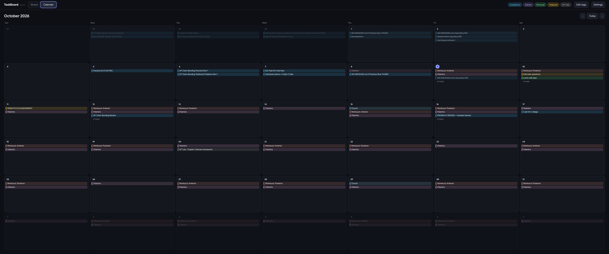

# TaskBoard

Trello-style boards with a calendar built in. Click a day to see its to-do list, double-click it to open that day as a full board. Dark by default, with themes, custom colors, tags, and repeating tasks.



## Features

- **Boards** with draggable cards and your own columns. Checking a task moves it to the **Done** column (a column named Done, Complete, or Finished); unchecking puts it back.
- **Calendar** with every task on its due date. Click a day for its checklist, double-click for that day's board. The app can open straight to today's board.
- **Colors and tags**: any color per task, saved colors you can reuse, and your own tags. Drag a tag from the top bar onto a task to apply it.
- **Repeating tasks**: every day, every N days, certain weekdays, or a rotation (like a workout cycle). Edit one any time, or push the whole schedule back a day if you missed one.
- **Groups**: give tasks the same group name (like "Vitamins") and they show as one card per day, with a check-all box and a fold-up arrow. Each task in it can still be checked or moved on its own.
- **Themes**: pick a preset (Midnight, Nord, Dracula, Gruvbox, Catppuccin, Tokyo Night, and more, including light ones) or set your own four colors. Settings, then Preferences.
- **Schoology import**: assignments from your Schoology calendar link (read-only, updates when teachers change dates).
- **Command bar**: press Tab (or Ctrl+K) and type where to go ("thursday", "oct 25", "settings", "upcoming"), or type a task like `do laundry thursday 4pm tag:personal` and press Enter to add it. Tags autocomplete after `tag:`.
- **Reminders**: a desktop notification before each task that has a time (5 minutes to an hour ahead, or right at the time), plus an optional morning list of the day's tasks. Click one to jump to the task. On Windows the app keeps running in the tray when you close it, so reminders still arrive; you can also have it start when you sign in. All of this is in Preferences.
- **Automatic updates**: the Windows installer and the Linux AppImage download new versions from GitHub in the background and install them when you restart.
- **Mouse back button** steps back: closes a dialog, returns from a day's board to the calendar, and so on.

## Install

### Windows (easiest)

1. Open the **Releases** page of this repository and download `TaskBoard-Setup-x.y.z.exe` (installer) or `TaskBoard-Portable-x.y.z.exe` (portable, no install).
2. Run it. Windows may show a "Windows protected your PC" screen because the app isn't code-signed. Click **More info**, then **Run anyway**.

The installed version updates itself: when a new release is out it downloads in the background, shows a "Restart now" button, and otherwise installs the next time you quit. The portable version can't replace itself, so it tells you when a new version is out and links to the download.

### From source (Windows, macOS, or Linux)

You need [Node.js](https://nodejs.org) 20 or newer.

```bash
npm install
npm run dev      # development, reloads as you edit
npm start        # build once and run
```

### Arch Linux (and other distros with a system Electron)

Installing Electron through npm can fail on some setups. The system package works well:

```bash
sudo pacman -S electron nodejs npm
npm install
npm run dev:system     # development
npm run start:system   # build once and run
```

Add TaskBoard to your app launcher, with its icon:

```bash
sh scripts/install-linux.sh
```

On Hyprland the launcher and dock match a window to its icon by window class. TaskBoard uses the class `taskboard`. If the icon is still missing, check the class with `hyprctl clients | grep -i -A3 taskboard` and make sure `StartupWMClass` in `~/.local/share/applications/taskboard.desktop` matches it.

## Where your data lives

| Platform | Folder |
| --- | --- |
| Linux | `~/.config/taskboard/` |
| Windows | `%APPDATA%\taskboard\` |
| macOS | `~/Library/Application Support/taskboard/` |

- `data.json` has your boards, tasks, tags, and repeating tasks.
- `settings.json` has your theme and sync settings, including your private Schoology calendar link. Don't share or commit it.

To move to a new computer, copy that folder across.

## Connecting your classes

**Schoology**: in Schoology open Settings, find "Share your Schoology Calendar", enable it, and copy the link. In TaskBoard open Settings, then Schoology, and paste it. It syncs when the app opens and hourly while it's running. Your own edits (done, colors, tags, notes) are never overwritten.

## Releasing a new version

```bash
npm version minor        # or patch; bumps package.json and creates the v-tag
git push --follow-tags
```

The Release workflow builds the Windows and Linux apps and attaches them, along with `latest.yml` / `latest-linux.yml`, to a GitHub Release. Installed copies check that release every 6 hours (and shortly after starting) and update themselves. Don't mark the release as a draft or pre-release, or the updater won't see it.

## Project layout

- `electron/` window creation, tray, saving data, fetching calendar feeds; `updater.cjs` handles updates
- `src/lib/reminders.js` task reminder notifications
- `src/lib/db.svelte.js` all app state and logic (boards, tasks, repeating tasks, imports)
- `src/lib/*.svelte` the screens: `Board`, `Calendar`, `DayPanel`, `TaskModal`, `SeriesManager`, `PreferencesModal`, and so on
- `src/lib/theme.js` theme presets; `src/app.css` the derived color palette
- `build/` app icon; `docs/` README screenshot; `scripts/` Linux launcher installer
